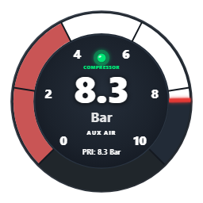
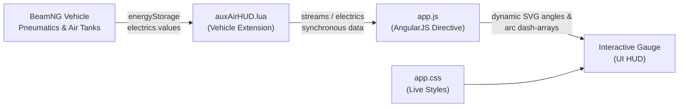

# Auxiliary Air Pressure HUD for BeamNG.drive 🚚💨

[](https://beamng.com)
[](https://github.com/FarazK-007/BeamNG-AuxAirPressureHUD/releases)
[](LICENSE)
[](https://beamng.com)
[](https://github.com/FarazK-007/BeamNG-AuxAirPressureHUD)

An OEM-styled, interactive digital-analog circular instrument gauge HUD for **BeamNG.drive** that monitors real-time **Auxiliary** and **Primary** air tank pressures, compressor charging activity, and low-air safety warnings in commercial trucks, buses, trailers, and pneumatic vehicles.

---

<p align="center">
  
  <br>
  <em>Auxiliary Air Pressure HUD in [2. Full Bar Mode] with active compressor indicator, sweeping arc, and red danger sector.</em>
</p>

---

## 📖 About This Mod

In heavy commercial vehicles (such as semi-trucks, transit buses, and heavy trailers), the pneumatic system is divided into multiple critical reservoirs:
- **Primary Circuit (`PRI`)**: Powers the service brakes.
- **Secondary / Auxiliary Circuit (`AUX`)**: Powers auxiliary systems such as air suspension bags, cab leveling, trailer air supply, pneumatic horn, PTO, and secondary braking circuits.

While default BeamNG apps only display basic brake pressure or generic text bars, **Auxiliary Air Pressure HUD** introduces a purpose-built instrument gauge designed to match the look and feel of authentic truck cockpits (Peterbilt, Kenworth, Freightliner, MAN, Scania, and Gavril).

---

## ✨ Features

- **⚡ Real-Time Pneumatic Tracking (Zero Lag)**:
  - Synchronously streams live tank pressure from vehicle Lua directly into the SVG gauge with zero lag or smoothing delay.
  - Monitors dedicated auxiliary tanks (`auxAirTank`, `secondaryAirTank`, `auxTank`, etc.).
  - Automatically identifies single-circuit trucks (like stock Gavril T-Series) where secondary air is fed from the primary reservoir, clearly labeling them `SHARED CIRCUIT`.
- **🔄 Interactive 3-Mode Tap Switcher**:
  - Simply click/tap anywhere on the HUD while driving to seamlessly cycle between three specialized view modes:
    1. **Full PSI Gauge**: Authentic American truck gauge calibrated from **0 to 150 PSI** with 30 PSI increments.
    2. **Full Bar Gauge**: European & ISO metric gauge calibrated from **0 to 10.0 Bar** with 2 Bar increments.
    3. **Minimal Clean Mode**: Sleek, distraction-free floating sweeping arc with a centered charging bulb and high-visibility alert text.
  - Preferences persist across game restarts and map reloads using browser `localStorage`.
- **🎯 Dynamic Sweeping Arc & Red Needle Indicator**:
  - Sweeping solid arc advances synchronously with air pressure.
  - Sharp red indicator bar at the leading edge.
  - Radial tick dividers slice the track at every numbered dial division.
- **🚨 0.75 Opacity Red Danger Sector (0 – 40% Scale)**:
  - The critical low-air zone (0–60 PSI / 0–4 Bar) sits distinctly over the gauge track with authentic translucent red styling (`#b71c1c` at 0.75 opacity), perfectly mimicking real printed gauge face warning sectors.
- **⚠️ Active Low-Air Warning System**:
  - When auxiliary pressure falls below safe DOT thresholds (< 60 PSI / < 4.1 Bar / < 414 kPa), the active sweeping arc instantly turns pulsing warning red (`#ff1744`), and a high-visibility `⚠️ LOW AIR` alert appears.
- **🟢 Live Compressor Status Bulb**:
  - Real-time emerald charging bulb with an aura glow, glass highlight, and `COMPRESSOR` status readout that illuminates only when the engine air compressor is actively pumping, and extinguishes when the governor reaches cut-out pressure.
- **👻 Zero-Footprint Auto-Hiding**:
  - Automatically detects whether the currently driven vehicle is equipped with a pneumatic air system. If you switch to an ordinary car without air brakes, the HUD completely and automatically hides itself.
- **🎨 Live Hot-Reloading for Tweaks**:
  - Built with live cache-busting so any styling modifications in `app.css` immediately reload on <kbd>Ctrl+L</kbd> without restarting the game.

---

## 🎛️ Interactive Modes Breakdown

| Mode | Appearance | Best Used For |
| :--- | :--- | :--- |
| **1. Full PSI Mode** | 270° circular dial, 0–150 PSI scale, tick marks at 0, 30, 60, 90, 120, 150 PSI, bold white digital readout, compressor status, and bottom `PRI: xxx PSI` readout. | American heavy haulers (Gavril T-Series, Gavril MD-Series, Peterbilt/Kenworth mods). |
| **2. Full Bar Mode** | 270° circular dial, 0–10.0 Bar scale, tick marks at 0, 2, 4, 6, 8, 10 Bar, bold white digital readout, compressor status, and bottom `PRI: x.x Bar` readout. | European trucks (MAN, Scania, Mercedes-Benz, DAF mods) and modern ISO metric vehicles. |
| **3. Minimal Clean Mode** | Center slate disc, scale numbers, and compressor text are hidden. Only the sweeping arc, red needle, centered charging bulb, clean `AUX AIR` label, and flashing low-air warnings remain visible. | Streamlined cockpits, ultra-wide setups, cinematic gameplay, or minimal HUD enthusiasts. |

> **Tip**: Click or tap anywhere on the HUD gauge to cycle through `PSI` ➔ `Bar` ➔ `Minimal Clean Mode`.

---

## 🚛 Compatible Vehicles

This mod automatically binds to any vehicle featuring BeamNG's pneumatic powertrain or pressure tank energy storage, including:

- **Gavril T-Series** (All conventional & cabover variants, upfits, and dump/cement/sleeper configurations)
- **Wentward 5000 Series / Citybus** (All pneumatic transit bus models)
- **Gavril MD-Series** (Medium-duty commercial configurations equipped with air brake packages)
- **Commercial Semi-Trailers & Dollies** (Dry vans, flatbeds, tanker trailers, log trailers, lowboys with air lines)
- **Community Mod Trucks** (B-Double setups, Australian road trains, European cab-overs, heavy crane chassis)

---

## 📥 Installation

### Method 1: Standard Mod Installation (Recommended for Players)

1. Download **`AuxAirPressureHUD.zip`** from the [Releases](https://github.com/FarazK-007/BeamNG-AuxAirPressureHUD/releases) section (or from this repository).
2. Move `AuxAirPressureHUD.zip` directly into your BeamNG.drive user mods folder:
   - **Windows Default**:
     ```
     %LocalAppData%\BeamNG.drive\current\mods\
     ```
     *(Full path: `C:\Users\<YourUsername>\AppData\Local\BeamNG\BeamNG.drive\current\mods\`)*
   - **Linux / Steam Deck (Proton)**:
     ```
     ~/.local/share/Steam/steamapps/compatdata/284160/pfx/drive_c/users/steamuser/AppData/Local/BeamNG.drive/current/mods/
     ```
3. Launch **BeamNG.drive**.
4. Go to **Mod Manager** from the main menu and ensure **Auxiliary Air Pressure HUD** is active (checked).

---

### Method 2: One-Click PowerShell Script (Windows)

If you cloned or downloaded this repository on Windows, you can automatically package and install the mod with one command:

```powershell
powershell -ExecutionPolicy Bypass -File .\install_mod.ps1
```

This script automatically verifies directories, creates `AuxAirPressureHUD.zip`, and copies it to your active BeamNG mods directory.

---

### Method 3: Live Developer Setup (Instant Hot-Reloading)

If you plan to modify or customize the gauge:

1. Create a directory junction from BeamNG's live UI apps folder directly to this repository:
   ```cmd
   mklink /J "%LocalAppData%\BeamNG.drive\current\ui\modules\apps\AuxAirPressureHUD" "D:\Path\To\AuxAirPressureHUD\ui\modules\apps\AuxAirPressureHUD"
   ```
2. Any changes you make to `app.css` or `app.js` will instantly reload in BeamNG by pressing <kbd>Ctrl+L</kbd> in-game!

---

## 🎮 How to Use In-Game

1. **Spawn a Vehicle**: Spawn any air-brake truck (e.g. **Gavril T-Series**).
2. **Open the Apps Menu**:
   - Press <kbd>Esc</kbd> to bring up the side menu.
   - Click **UI Apps** (or press the App Edit icon).
3. **Add the App**:
   - Click **Add App** (`+`).
   - Find or search for **Auxiliary Air Pressure HUD**.
   - Click to place it onto your screen.
4. **Position & Resize**:
   - Drag the HUD to your preferred position (bottom-right dashboard corner recommended).
   - Use the corner handle to resize to your desired scale.
   - Click the green checkmark to save your layout.
5. **Cycle Modes**:
   - Single-click or tap anywhere on the gauge to cycle between **PSI**, **Bar**, and **Minimal Mode**.
6. **Watch it Work**:
   - Apply the brakes repeatedly or dump trailer air to watch the gauge sweep down into the red sector and trigger the `⚠️ LOW AIR` warning.
   - Idle or rev the engine to watch the emerald `COMPRESSOR` bulb light up as the compressor refills the reservoir!

---

## 🛠️ Mod Structure & Architecture

```
AuxAirPressureHUD/
├── .gitignore                                     # Git ignore rules
├── LICENSE                                        # MIT License
├── README.md                                      # Project documentation & guide
├── mod_info.json                                  # BeamNG mod packaging metadata
├── install_mod.ps1                                # Automated PowerShell build script
├── render_thumbnail.html                          # Developer SVG tool for app.png rendering
├── AuxAirPressureHUD.zip                          # Ready-to-install packaged mod archive
│
├── lua/
│   └── vehicle/
│       └── extensions/
│           └── auto/
│               └── auxAirHUD.lua                  # Auto-loading vehicle Lua extension
│
└── ui/
    └── modules/
        └── apps/
            └── AuxAirPressureHUD/
                ├── app.json                       # UI app metadata & default geometry
                ├── app.js                         # AngularJS directive, SVG DOM & logic
                ├── app.css                        # Gauge styles, animations & typography
                └── app.png                        # 256x256 UI app selector icon
```

### How It Works:


1. **`auxAirHUD.lua`**: Runs inside the vehicle simulation Lua VM. Every graphic frame (`updateGFX`), it inspects `energyStorage` and `powertrain` devices to read relative reservoir pressure (PSI, Bar, kPa), compressor clutch status, and circuit topology.
2. **`app.js`**: An AngularJS component that listens to the vehicle streams, converts pressures, calculates 270° trigonometric stroke-dasharray arcs and needle rotation angles, handles mode clicks, and syncs preferences to `localStorage`.
3. **`app.css`**: Renders all visual styling, high-contrast drop-shadows, animations (`auxLowAirBlink`), and allows instant hot-reloading.

---

## 🎨 Customization Guide

Want to tweak the gauge colors, fonts, or opacity? You can easily edit [`app.css`](ui/modules/apps/AuxAirPressureHUD/app.css):

| Setting | CSS Selector in `app.css` | Example Modification |
| :--- | :--- | :--- |
| **Danger Sector Opacity** | `.aux-danger-sector` | Change `opacity: 0.75;` to `opacity: 0.5;` or `1.0;` |
| **Danger Sector Color** | `.aux-danger-sector` | Change `stroke: #b71c1c;` to any hex color |
| **Sweeping Arc Low Air Color** | `.aux-active-arc.low-air` | Change `stroke: #ff1744;` |
| **Digital Readout Font Size** | `.aux-boost-val` | Change `font-size: 132px;` |
| **Compressor Status Text Size** | `.aux-compressor-text` | Change `font-size: 18px;` |
| **Minimal Mode Warning Color** | `.aux-minimal-low-air-big` | Change `fill: #b71c1c;` |

After saving your changes in `app.css`, simply press <kbd>Ctrl+L</kbd> in BeamNG to see the updates immediately!

---

## ❓ Troubleshooting & FAQ

#### Q: The HUD does not appear on my screen!
- **A**: The HUD includes a smart auto-hide feature. It only appears when driving a vehicle equipped with an air brake/pneumatic system (e.g. Gavril T-Series, Wentward Citybus). If you spawn a standard car like the Ibishu Covet, the HUD remains invisible by design.

#### Q: How do I switch between PSI and Bar?
- **A**: Single-click or tap anywhere on the gauge face. It toggles sequentially: **PSI** ➔ **Bar** ➔ **Minimal Mode**.

#### Q: The gauge shows `SHARED CIRCUIT`. What does this mean?
- **A**: Some trucks (such as the base single-tank Gavril T-Series configurations) share one common air reservoir for both the primary brakes and auxiliary accessories. When this is detected, the HUD accurately informs you that both systems are drawing from the same tank.

#### Q: Can I resize the gauge?
- **A**: Yes! Open the **UI Apps** editor in BeamNG (<kbd>Esc</kbd> ➔ **UI Apps**), select the Auxiliary Air Pressure HUD, and drag its bottom-right resize corner.

---

## 📄 License

This project is licensed under the **MIT License** — see the [LICENSE](LICENSE) file for details.  
BeamNG.drive is a registered trademark of BeamNG GmbH. This mod is an independent community creation.

---

<p align="center">
  <b>Built with ❤️ for the BeamNG.drive Trucking & Modding Community</b>
</p>
